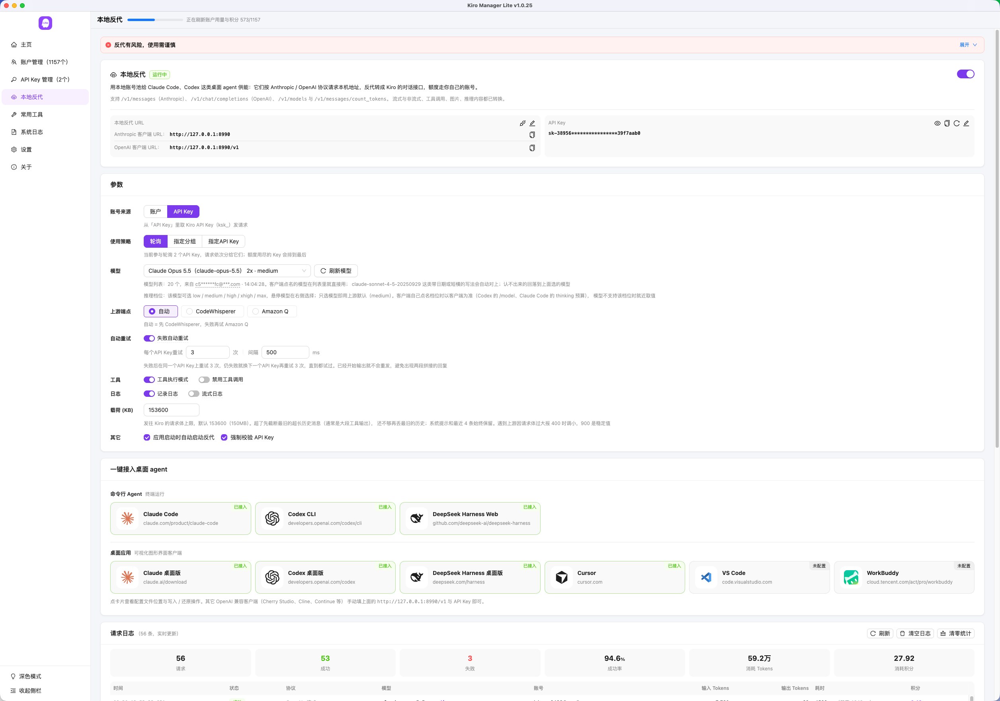
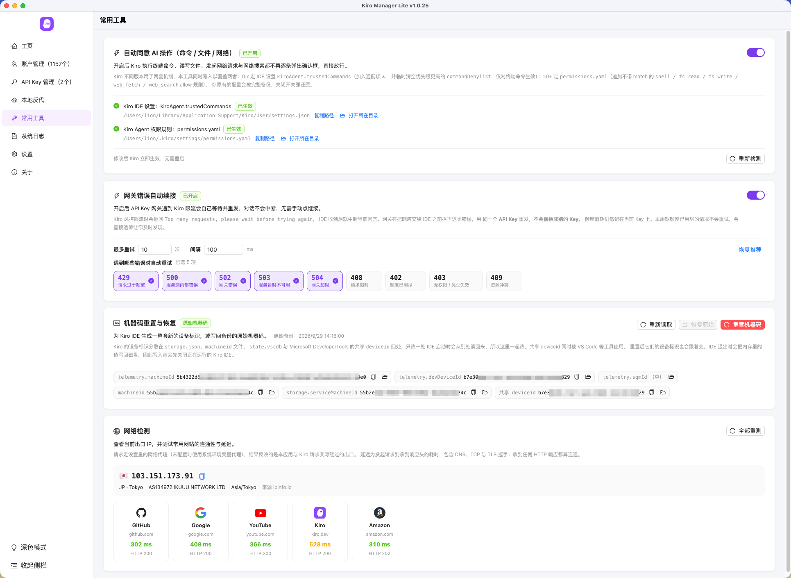

<p align="center">
  
</p>

<h1 align="center">Kiro Manager Lite</h1>

<p align="center">
  <strong>Kiro 多账号与 API Key 管理器轻量版</strong>
</p>

<p align="center">
  Kiro 多账号 / APIKey管理 · 快捷登录 Kiro IDE / CLI / Crew · 本地反代与客户端接入 · 本地网关与调用统计 · 自动刷新密钥/积分 · 常用工具 · 内置隐私浏览器 · 托盘常驻
</p>

<p align="center">
  
  
  
  
  
  
</p>

---

## ✨ 功能特性

### 🏠 主页

- 按时段问候，凭据总数、账号数、API Key 数与正常 / 异常数一目了然（正常与异常把账号和 API Key 合并统计）
- 账户额度统计与 API Key 额度统计左右并排：总额度、已使用、可用额度、使用率与总体进度；降档导致的「已用超过额度」单独提示，可用额度按 0 计
- 「当前使用」一排三张卡：Kiro IDE 账号、Kiro CLI / Crew 账号、本地网关正在使用的 API Key，样式与列表的紧凑卡片一致，点卡片打开详情抽屉；一键重新检测两端登录状态

### 🔐 多账号管理

**添加与列表**

- 五种添加方式：Google / GitHub 社交登录、AWS Builder ID 设备码、Enterprise IAM Identity Center SSO、OIDC 凭证、读取本机已登录的 Kiro 凭证
- 搜索、按状态 / 订阅 / 登录方式 / 积分占比 / 总积分 / 剩余积分 / 导入时间范围（精确到时分秒）筛选、排序、多选与批量操作；上千账号用虚拟列表保持流畅
- 自定义分组：新建 / 改名 / 删除、长按拖动排序，按分组（含「未分组」）多选筛选，可批量把选中账号移入或移出分组，卡片上直接显示分组标签
- 卡片显示邮箱、昵称、备注、订阅档位、积分占比与 Token 剩余时间；备注可自己填，用于标记用途或来源
- 三种展示形态可切换并记住选择：卡片、卡片紧凑（收起额度明细）、列表（一排一个的横向长条，一屏能看几十个）
- 详情抽屉展开订阅档位、积分构成、超额费率、Token 有效期与完整凭证，支持一键复制

**换号与保活**

- 一键把账号凭证写入 Kiro IDE 切换当前登录身份，可选切号后自动重启 IDE
- 一键登录 Kiro CLI（含 Kiro Crew），或「全部登录」同时写入 IDE 与 CLI；登录前先检测本机是否安装 kiro-cli / Kiro Crew，未安装时给出当前平台的安装命令。macOS 与 Windows 均支持，卡片上分别标出「IDE 使用中」「CLI 使用中」
- 切号前会逐个实测 `profileArn` 候选再落盘 —— 写错这个字段是 IDE 报「Invalid token」的主因
- 批量刷新 Token / 用量与积分，支持定时自动刷新；「主动续期」会在 IDE 当前账号的 Token 剩约 15 分钟时抢先续期并写盘，避免 IDE 自己刷新时撞车被登出
- 真实流式对话测活：实时看输出、随时中止。只有 runtime 面的真实对话才能暴露封禁账号；响应区可「查看完整响应」，列出发给官方的每次请求与原始返回（成功、失败、中止都能看）
- 测活的模型改为可搜索的级联选择，二级是该模型自己的推理档位（Claude 系 low / medium / high / xhigh / max，GPT 系另有 none，没有这一层的模型不显示二级）；只选主模型时自动补上它的默认档位

**账号 API Key**

- 卡片上的钥匙图标直接用该账号凭证向 Kiro 控制面申请 Key，并列出它已创建的全部 Key（名称、前缀、创建时间）
- 完整明文上游只在创建时返回一次，因此生成后单独弹窗展示，可复制或一键添加到 API Key 管理；关闭后列表里只剩前缀
- 批量生成：勾选多个账号后在「批量操作」里为每个账号各生成一个 Key，按顺序逐个执行、单个失败不影响后续，可中止与重试失败项；生成后可复制全部或通过批量导入添加到 API Key 管理

**订阅管理**

- 点卡片上的订阅标签即进订阅管理，弹窗内先查状态再分流：已订阅的账号直接用内置浏览器打开 Stripe 账单页（改套餐、退订都在那边做），未订阅的账号列出官方可开通的档位
- 档位卡片显示名称、价格、计费周期与特性，并标出当前套餐；每个档位两个动作 —— 生成支付链接并用内置浏览器打开，或只把链接复制到剪贴板（想换个地方付款、先存下来都不用打开浏览器）
- 查询前按需为该账号续期 Token：门户的订阅接口认的是 cookie 里的 AccessToken，而 IDE 只续它自己在用的那个账号
- 查询失败就地显示原始报错并附「关闭 / 重试」，不必关掉重开
- **批量生成订阅链接**：勾选多个账号后在「批量操作」里选一个订阅档位（用勾选的第一个账号向官方查询可开通档位），为每个账号逐个生成 Stripe 订阅链接；
  已有订阅的账号判为失败，单个失败不影响后续，可中止与重试失败项。生成后每行可用内置浏览器打开或复制，也可下载 txt（`邮箱----订阅链接`）

**前往官网**

- 用该账号凭证在应用内的私密窗口直接进 Kiro 官网后台，省去先切号再手动登录
- 会话分区不持久化、退出即清，也不碰你自己浏览器里的登录身份；每次打开前先清空 cookie，避免显示上一个账号
- 页面内的跳转全程留在应用内（含站外链接与二级弹窗），不会跳到系统浏览器丢掉会话
- 自带工具条：后退 / 前进 / 刷新、可跳任意网址的地址栏、加载进度条，以及「更多」菜单（IP 查询、打开百度、复制链接、开发者工具等）；弹出的窗口同样带完整工具条
- 首屏卡住会自动重试并把进度显示在标题位，次数用尽才给错误页，不再干等 30 秒白屏
- 请求头伪装成普通 Chrome，并可在设置的「内置浏览器」里指定地区（内置 50 个常用地区，也支持自定义 BCP 47 标签）

### 🔑 API Key 管理

- 支持单个添加、批量导入、搜索、订阅 / 状态 / 用量 / 总积分 / 剩余积分 / 重置时间 / 导入时间范围筛选、排序、导出和批量删除
- 与账号列表同一套自定义分组：新建 / 改名 / 删除、长按拖动排序、按分组多选筛选、批量设置分组，卡片上显示分组标签
- 同样有卡片、卡片紧凑、列表三种展示形态可切换并记住选择
- 每个 Key 独立绑定区域，展示订阅档位、注册邮箱、User ID、额度、重置时间和异常原因
- 支持单个与批量刷新、真实对话测活、批量测活；测活的模型同样是可搜索的级联选择，能选推理档位并显示消耗倍率
- 大量 Key 使用虚拟网格渲染；详情、历史、测活和导入导出弹窗均按需挂载，减少首屏开销

### 🌐 本地网关与调用统计

- 本地 KRS / CPS 网关可将 Kiro IDE 请求接管到指定 API Key，支持运行中即时切换 Key
- 自动探测当前 Kiro 版本是否真正支持自定义网关端点，并监视配置被 IDE 回写后的自动恢复
- 按真实请求统计请求数、成功率、RPM 和服务端权威积分消耗，辅助请求与对话请求分开计数
- 网关调用历史按分钟聚合并持久化，可查看请求数 / 成功率 / 积分曲线、明细和汇总数据
- 可选「网关错误自动续接」，按状态码、次数和固定间隔重试可恢复错误，不掩盖额度耗尽问题

### 🔁 本地反代

把账号池转成标准的大模型接口，Claude Code、Codex、Cursor、VS Code 等客户端直接当作自己的模型服务来用。

12 个客户端的接入效果见 **[一键接入实测截图](docs/proxy/proxy-clients.md)**。

**接口与协议**

- 兼容 OpenAI（`/v1/chat/completions`、`/v1/responses`、`/v1/models`）、Anthropic（`/v1/messages`、`/v1/messages/count_tokens`）与 Gemini（`/v1beta/models/*:generateContent`），另有 `/health` 与 `/admin/*` 运维接口
- 流式输出、工具调用、图片输入与推理档位完整转换；客户端点名的模型自动映射，带日期或短横的写法也认
- 「API 端点」弹窗列出全部接口，可在线请求、查看格式化响应并复制原文或请求示例
- 默认只监听 `127.0.0.1`，可改端口或开放给局域网；默认强制校验 API Key

**账号调度**

- 账号来源二选一：账号管理里的 OAuth 账号，或 API Key 管理里的 Kiro API Key（`ksk_`）
- 使用策略：轮询全部、指定分组（显示成员数，分组成员变化实时生效）、指定账号（可多选），选中范围内按请求轮询
- 自动重试可开关：同一个号按间隔重试 x 次，仍失败静默换下一个号继续；额度耗尽、被封、凭证失效的号直接跳过；已开始输出后绝不重发
- 上游端点可选自动 / CodeWhisperer / Amazon Q；请求体超限时先截断最旧的长消息，再整条丢弃最旧历史

**工具与模型**

- 模型列表从当前选中的号实时拉取，带上下文与输出上限、推理档位与消耗倍率
- 工具执行模式：由反代调用 Kiro 自带的联网搜索并把结果交回模型，不依赖任何第三方搜索服务；搜索结果在后续轮次自动补回历史，客户端自带搜索工具的（DeepSeek Harness）交给客户端执行
- 可一键禁用工具调用，只做纯对话

**Key 与统计**

- 多个 `sk-` API Key：可命名、设积分额度，用完返回 429；每个 Key 有请求数、积分、Tokens、完整用量明细、按模型统计与每日折线图（默认最近 7 天，可自选日期范围）
- 请求日志与统计持久化，按表格展示状态、协议、模型、账号、输入 / 输出 Tokens、耗时与积分，汇总消耗 Tokens 与消耗积分

**一键接入客户端**

- 命令行：Claude Code、Codex CLI、DeepSeek Harness Web，给出启动命令并可直接打开终端运行
- 桌面应用：Claude 桌面版（3P）、Codex 桌面版、DeepSeek Harness 桌面版、Cursor（CCursor）、VS Code（Copilot 自定义端点）、WorkBuddy、Qoder CN、ZCode、Kimi Code
- 写入前检测是否安装并完整备份。共用的配置文件只改我们那一部分，还原也只摘掉这部分，你自己的设置原样保留
- 模型、上下文上限与推理档位按账号实时写入；检测到系统代理拦截回环地址时提前提示

### 📈 用量与历史

- 账号和 API Key 每次刷新都会记录积分变化，支持平滑趋势曲线、明细表、清空与 Excel 导出
- 历史曲线采用不过冲的单调平滑插值，时间轴末端标签完整显示
- 删除账号或 Key 时同步清理关联历史、网关统计和备份残留，避免孤儿数据继续占用存储

### 📦 导入与导出

- 账号支持卡密、精简 JSON、完整备份 JSON、CSV 和 TXT，可粘贴内容或一次选择多个文件导入
- 导出范围只有一条规则：**勾选了就导勾选的，没勾选就导全部**，不需要在弹窗里再选一次
- API Key 导出两种格式：`apikey----地区`（分隔符与卡密一致，可回导并还原区域）或每行一个裸 Key
- 选中多个账号时可「导出为压缩包」或「逐个分割导出」：后者每个账号一个独立文件、外加一个整批的 `all` 文件，一起打成压缩包，文件名与单个导出一致，取出即可回导
- 导出可保存到文件或复制到剪贴板，账号导出可选择是否包含敏感凭证
- 导出成功后自动打开所在文件夹并选中该文件，也可在设置里关掉
- 账号与 Key 的大批量校验 / 刷新并发数均可配置

### 🧰 常用工具

- **自动同意 AI 操作**：配置 Kiro 的命令、文件和网络操作权限，开启前明确展示安全风险，关闭时原样恢复
- **网关错误自动续接**：集中配置重试状态码、次数与间隔
- **机器码重置与恢复**：一次性重置 Kiro IDE 分散在 `storage.json`、`machineid`、`state.vscdb` 与共享 `deviceid` 四处的设备标识（只改一处 IDE 会从别处读回）；首次重置前自动备份原始值，可一键恢复，每项都能复制或定位文件；写入前自动关闭正在运行的 IDE
- **网络检测**：查看当前出口 IP 的国家、地区、运营商与时区，一键测试 GitHub、Google、YouTube、Kiro、Amazon 的连通性与延迟；走设置里的代理，看到的就是 Kiro 请求实际经过的出口
- **Kiro UA 请求头版本号**：按官方真实组合切换 UA 里上报的 Kiro IDE 与 AWS SDK 版本，级联选择保证两者成对（对照表由 `scripts/kiro-sdk-versions.sh` 逐个解析官方安装包生成）；修改与恢复默认都需二次确认，反代、测活、用量、令牌刷新与网关统一生效
- **出站域名统计**：记录本应用对外访问过的所有域名，按完整主机名去重，可查看每个域名的出站明细并导出 Excel
- 工具状态、目标配置路径和不兼容原因均在页面内可视化展示

### 🧾 系统日志

- 主进程与渲染进程日志汇入同一时间线，支持关键字、时间、分类和级别筛选
- 内存环形缓冲保留最近 5 万条，磁盘分片落盘并自动清理，虚拟滚动可承载数万行
- 支持跟随最新日志、导出筛选结果、打开日志目录和一键清空；向上查看历史时不会被新日志强制拉回底部

### ⚙️ 个性化设置

- 主题风格（自动 / 浅色 / 深色）、主题色（7 种预设，默认紫罗兰）、布局风格（左右布局 / 上下布局，上下布局把导航放到窗口顶部）、控件尺寸（默认 / 大尺寸，两个列表页的工具栏那一排跟着一起变）、积分精度与删除前确认
- **隐私打码**：一键遮住邮箱、昵称、API Key、User ID、备注与分组标签，截图或录屏前很有用。
  列表工具栏「隐私打码」旁的设置图标可分别为账号与 API Key 勾选打码内容（账号的邮箱、API Key 的 Key 始终打码）；
  邮箱的遮罩串由 md5 前缀生成，同一账号每次结果一致，打码状态下仍能横向比对是不是同一个号
- **内置浏览器**：指定应用内打开的网页使用哪个地区，50 个常用地区可搜索选择，也可自定义 BCP 47 标签。
  只影响应用内的网页，不改界面语言、也不影响账号所属的 AWS 区域
- Token / 用量自动刷新间隔、主动续期、批量与导入并发数
- **数据管理**：账号、Kiro API Key、账号与 API Key 的用量记录、反代 API Key 导出为明文 `.json`（带导出时间与版本），导入时只替换文件里带的部分；
  「初始化」清掉全部数据并还原改过的外部配置，和初次安装一样；备份计划默认开启，每 30 分钟静默备份一次、保留最新 3 份，周期与份数可改
- REST / CBOR 用量接口、HTTP 代理、网关端口，以及数据、备份和日志目录快捷打开

### 🖥️ 桌面端体验

- 系统托盘常驻，可查看当前账号、刷新、切号、复制邮箱和显示窗口；关闭行为支持最小化到托盘 / 退出 / 每次询问
- macOS 中文菜单栏、自定义协议 `kiro-manager-lite://` / `kml://` 和单实例唤起
- 管理页详情、图表和各类模态框按用户操作实时挂载，页面切换不再等待退出动画，减少大数据量下的白屏感
- 应用内更新：发现新版本后在应用里下载当前平台的安装包，显示进度并可随时取消，下载完校验 SHA-256（并排显示 GitHub 与本地的值）；「安装并重启」时应用先正常退出，再由安装助手打开系统安装器（macOS pkg）、安装向导（Windows）或替换 AppImage（Linux）
- 关于页手动检查更新会立即显示加载态；GitHub API 失败时自动重试并通过 Releases 页面兜底，失败后可重试或手动更新

---

## 📥 下载

<p align="center">
  <a href="https://github.com/lucks-cloud/kiro-manager-lite/releases/latest">
    
  </a>
  <a href="https://github.com/lucks-cloud/kiro-manager-lite/releases">
    
  </a>
</p>

**最新版本：v1.0.49**（2026-11-09） · 变更详情见 [CHANGELOG.md](CHANGELOG.md)

### 选择对应的安装包

<!-- 发版时与 package.json 的 version 一起改：版本号出现在本节的徽章、最新版本与下表每条直链里 -->

| 平台 | 文件 | 适用设备 | 快捷下载 |
| --- | --- | --- | --- |
| macOS (Apple Silicon) | `*-mac-arm64.pkg`（推荐）或 `*-mac-arm64.dmg` | Apple M 系列芯片 | [.pkg 安装包（推荐）](https://github.com/lucks-cloud/kiro-manager-lite/releases/download/v1.0.49/kiro-account-lite-1.0.49-mac-arm64.pkg) · [.dmg 镜像](https://github.com/lucks-cloud/kiro-manager-lite/releases/download/v1.0.49/kiro-account-lite-1.0.49-mac-arm64.dmg) |
| macOS (Intel) | `*-mac-x64.pkg`（推荐）或 `*-mac-x64.dmg` | Intel 芯片 | [.pkg 安装包（推荐）](https://github.com/lucks-cloud/kiro-manager-lite/releases/download/v1.0.49/kiro-account-lite-1.0.49-mac-x64.pkg) · [.dmg 镜像](https://github.com/lucks-cloud/kiro-manager-lite/releases/download/v1.0.49/kiro-account-lite-1.0.49-mac-x64.dmg) |
| Windows | `*-win-x64-setup.exe` | 64 位 Windows | [.exe 安装包](https://github.com/lucks-cloud/kiro-manager-lite/releases/download/v1.0.49/kiro-account-lite-1.0.49-win-x64-setup.exe) |
| Linux | `*-linux-x86_64.AppImage` | 64 位 x86 Linux | [.AppImage](https://github.com/lucks-cloud/kiro-manager-lite/releases/download/v1.0.49/kiro-account-lite-1.0.49-linux-x86_64.AppImage) |

不确定 Mac 是哪种芯片：**苹果菜单 → 关于本机**，看「芯片」一栏。

macOS 推荐用 `.pkg`：双击按向导安装，装好后打开应用不会再提示「已损坏」。

`.zip`、`.blockmap` 与 `latest*.yml` 是自动更新用的，手动安装不需要下载。

### 系统要求

| 平台 | 最低版本 | 架构 |
| --- | --- | --- |
| macOS | 13 Ventura | arm64 / x64 |
| Windows | Windows 10 | 仅 x64 |
| Linux | 主流发行版（Ubuntu / Debian / Fedora 等仍在维护的版本） | 仅 x64 |

版本门槛跟随 Electron 44（Chromium 152）的[平台支持范围](https://github.com/electron/electron#platform-support)。
**macOS 最低版本自 v1.0.38 起从 11 Big Sur 提高到 13 Ventura**（Chromium 已停止支持 macOS 12 及更早版本）；
仍在 macOS 11 / 12 的用户请继续使用 [v1.0.37](https://github.com/lucks-cloud/kiro-manager-lite/releases/tag/v1.0.37)。
Windows 与 Linux 暂不提供 arm64 包：原生依赖 `cbor-extract` 没有对应的预编译产物，
交叉编译在 CI 上必然失败。装机后约占 300–400 MB。

### 安装要点

- **Windows**：双击 `.exe` 安装。安装包未做代码签名，SmartScreen 可能提示「已保护你的电脑」，
  确认文件来自官方 Releases 后选「更多信息 → 仍要运行」即可，**不要为此关闭 SmartScreen 或杀毒软件**。
- **macOS**：推荐双击 `.pkg` 按向导安装；首次双击若被拦截，在「系统设置 → 隐私与安全性」中点「仍要打开」。
  用 `.dmg` 则拖入「应用程序」，未做公证，首次打开可能提示「已损坏」或「无法验证开发者」，
  DMG 里附了「安装指南.txt」说明处理办法。
- **Linux**：AppImage 免安装，`chmod +x` 后直接运行；缺 FUSE 时用 `--appimage-extract-and-run`。
- **升级**：先完全退出应用（含托盘 / 菜单栏后台进程），再用新包覆盖安装，用户数据不受影响。
  应用内「关于」页也能检查更新。

遇到系统拦截、架构选错、升级或卸载问题，完整排查步骤见 **[安装说明与常见问题](./INSTALL.md)**。

---

## 📸 截图

### 主页


### 账户管理


### 添加账号


### 在线登录


### 切换账号


### 账号 API Key 管理


### 账号测活


### API Key 管理


### API Key 网关


### 本地反代



各客户端一键接入后的实测截图见 [一键接入实测](docs/proxy/proxy-clients.md)。

### 常用工具



### 系统日志


### 设置


### 关于


---

## 🛠️ 技术栈

| 层 | 选型 |
| --- | --- |
| 前端框架 | Vue 3 + TypeScript |
| 桌面框架 | Electron 44 |
| 状态管理 | Pinia |
| UI 组件 | Ant Design Vue 4 |
| 构建工具 | Vite + electron-vite |
| 网络层 | undici（统一 fetch + 代理） |
| 持久化 | electron-store（加密存储 + 定时 JSON 备份） |
| 序列化 | cbor-x（Kiro 网页门户的 CBOR 接口） |

---

## 🚀 开发

```bash
# 安装依赖
npm install

# 启动开发环境
npm run dev

# 类型检查
npm run typecheck

# 类型检查 + 构建产物
npm run build

# 打安装包（win / linux 同理）
npm run build:mac
```

---

## 📂 目录结构

```
.
├── .github/workflows/
│   └── release.yml          推送 v* 标签后三平台构建，并生成带「快捷下载」直链的发布说明
├── build/                   打包资源
│   ├── background*.png      DMG 窗口背景（1x / Retina）
│   ├── entitlements.mac*.plist  macOS 权限声明
│   ├── icon.png             应用图标源图
│   ├── pkg-scripts/preinstall   pkg 安装前让仍在运行的应用正常退出
│   ├── pkg-scripts/postinstall  pkg 装完后清除隔离属性，避免提示「已损坏」
│   └── 安装指南.txt          打进 macOS DMG 的安装说明
├── docs/
│   ├── image/               README 用的 logo 与交流群二维码
│   ├── proxy/proxy-clients.md  一键接入客户端的实测截图
│   └── screenshots/         README 截图
├── resources/
│   ├── icons/               macOS / Windows 应用图标
│   └── tray/                托盘菜单图标
├── scripts/
│   ├── build-mac.mjs        macOS 打包：先打两架构的 dmg + zip，再按架构依次打 pkg
│   ├── clean.mjs            打包前清理 dist 与 out
│   ├── dev-register-kiro-scheme.sh  开发模式下给 Electron.app 声明 kiro:// 协议
│   ├── dmg-background.swift 生成 DMG 窗口背景图
│   ├── pad-mac-icon.py      把满幅图标缩放居中，符合 macOS 图标留边规范
│   └── kiro-sdk-versions.sh 下载官方 Kiro dmg，提取 IDE ↔ AWS SDK 版本对照表
├── src/                     源码，见下
├── electron-builder.yml     打包配置（产物命名：kiro-account-lite-<版本>-<平台>-<架构>）
├── electron.vite.config.ts  主进程 / preload / 渲染进程三端构建配置
├── tsconfig*.json           node 端与 web 端两套类型检查配置
├── CHANGELOG.md             更新日志
└── INSTALL.md               安装说明与常见问题
```

```
src/
  shared/                主进程与渲染进程共享的单一真源
    types.ts             共享类型与默认设置
    errors.ts            错误归一与「是否确定性失败」判定
    refreshPolicy.ts     刷新跳过策略（手动 / 自动共用一份）
    retryPolicy.ts       网关重试的状态码口径
    regions.ts           AWS 区域列表与分组
    portalLocale.ts      内置浏览器地区：预设、归一化、Accept-Language
    subscription.ts      订阅档位归一
    modelSchema.ts       从模型 schema 解析推理档位并拼请求字段
    proxyModels.ts       反代的模型名映射与兜底模型表
    itemGroups.ts        账号与 API Key 共用的多分组、回收站字段读写
    backupSchedule.ts    备份计划的周期定义与下次执行时间
    kiroVersion.ts       Kiro UA 请求头版本号：默认值、IDE ↔ SDK 对照表、版本号规范化
    privacyFields.ts     隐私打码的可选字段、默认范围与锁定项
    data/
      kiro-sdk-versions.json  scripts/kiro-sdk-versions.sh 生成的版本对照表
  main/
    index.ts             应用生命周期与窗口
    ipc.ts               IPC 注册与运行时设置下发
    appMenu.ts           macOS 中文菜单栏
    appProtocol.ts       自定义协议注册与唤起
    appearance.ts        主题风格同步给 Chromium
    ── 账号
    accountService.ts    校验 / 刷新 / 状态检查 / 切号
    onlineLogin.ts       在线登录：设备码、社交登录、Enterprise SSO
    proactiveRenewal.ts  Token 主动续期调度
    ── Kiro 接口与本体
    kiroApi.ts           Token 刷新、用户信息、用量与积分
    kiroApiKey.ts        账号维度的 API Key 申请与列表（控制面）
    kiroSubscription.ts  订阅：可开通档位与 Stripe 账单 / 结算链接（门户 CSRF 双提交）
    kiroAuth.ts          IDE 凭证文件读写与 profileArn 决策
    kiroCliAuth.ts       Kiro CLI / Kiro Crew 凭证库写入、whoami 校验与退出登录
    kiroCliEnv.ts        把 API Key 写成 Kiro CLI 认的 KIRO_API_KEY 环境变量
    kiroToolsInstall.ts  登录 CLI 前检测 kiro-cli 与 Kiro Crew 的安装情况
    kiroChat.ts          测活：模型列表与流式对话
    kiroEndpoints.ts     端点、区域映射与客户端 UA 的唯一定义（版本号来自设置，服务端按版本号准入）
    kiroMachineId.ts     机器码读取、重置、备份与恢复
    kiroSettings.ts      IDE settings.json 读写与端点接管
    kiroPermissions.ts   自动同意 AI 操作：两套机制读写与还原
    kiroCapability.ts    当前 IDE 版本是否支持自定义网关端点
    kiroProcess.ts       IDE 进程检测、打开、关闭与重启
    kiroPortal.ts        内置浏览器：私密窗口、工具条、看门狗重试与地区
    ── API Key 网关
    keyService.ts        Key 管理与网关编排
    keyGateway.ts        本地 KRS / CPS 转发
    gatewayStats.ts      请求数、成功率、RPM 与积分统计
    gatewayHistory.ts    按分钟聚合的调用历史持久化
    eventStream.ts       AWS event-stream 帧解析
    localPorts.ts        端口占用探测与释放
    ── 本地反代
    proxyServer.ts       HTTP 服务、路由、鉴权、日志与统计
    proxyConvert.ts      OpenAI / Anthropic / Gemini 与 Kiro 请求响应互转
    proxyUpstream.ts     选号策略、重试换号与上游事件流解析
    proxyClients.ts      各客户端的一键写入、检测、重启与外科式还原
    proxyClientInstall.ts  各客户端的安装位置查找（macOS / Windows 分开处理）
    proxyKeys.ts         反代 API Key 与按 Key 用量
    proxyLogStore.ts     请求日志与统计持久化
    proxyUsageStore.ts   按账号、按反代 Key 的用量统计（独立小文件，合并落盘）
    kiroWebSearch.ts     Kiro MCP 联网搜索
    searchMemory.ts      代执行的联网搜索结果跨请求保留
    ── 基础设施
    net.ts               统一 fetch 与代理
    networkCheck.ts      出口 IP 查询与网站连通性测试
    outboundLog.ts       出站域名统计
    store.ts             加密持久化与设置读写（含旧默认值迁移）
    dataBackup.ts        数据导出 / 导入（明文 JSON）与初始化
    backupScheduler.ts   备份计划：按周期静默导出，只保留最新几份
    usageHistory.ts      积分历史（防抖落盘）
    logger.ts            内存环形缓冲、分片落盘、接管 console
    tray.ts              系统托盘
    updater.ts           版本检查，并带出当前平台安装包的大小与 SHA-256
    updateInstaller.ts   应用内更新：下载、校验、拉起安装助手并正常退出
    browser.ts           系统浏览器唤起
    childEnv.ts          拉起其它应用时剥离本应用自身的环境变量
    xlsxWriter.ts        Excel 导出
    utils.ts             主进程通用小工具
  preload/               contextBridge 暴露的 API 白名单
    index.ts             主窗口用
    index.d.ts           渲染进程可见的 window.api 类型
    portalBar.ts         内置浏览器工具条用，与主窗口完全隔离
  renderer/src/
    App.vue / main.ts    根组件与启动入口（加载账号与 API Key、启动自动刷新）
    router/              路由
    stores/              Pinia：accounts / keys / proxy / settings / update
    views/               Home / Accounts / Keys / Proxy / Tools / Logs / Settings / About
    components/
      layout/            侧栏、顶部导航、标题栏
      home/              主页的「当前使用」卡片与额度统计卡
      accounts/          账号卡片、详情抽屉、添加 / 导入 / 导出、测活、订阅、批量操作
      keys/              API Key 卡片、详情抽屉、导入 / 导出、测活、网关历史、CLI 环境变量
      proxy/             反代的客户端图标、接口列表、反代 Key 管理
      tools/             常用工具卡片：机器码、Kiro UA 请求头版本号、出站域名、网络检测
      common/            两个列表页共用：筛选、分组、排序、批量查询、隐私打码、模型级联、虚拟列表等
    composables/         隐私打码判断、列表多选、右键菜单、流式测活、近期用量、图表尺寸
    utils/               格式化、打码、导入导出、Key 派生值、级联定位、图表、托盘桥接等
    assets/              全局样式与图片
```

---

## 🔒 安全说明

- 账号凭证保存在本机 electron-store 加密文件里，不会上传到任何第三方服务
- 渲染进程开启 contextIsolation、关闭 nodeIntegration，所有系统调用走 preload 白名单
- 导出内容包含可直接登录的凭证，请勿放到公开位置；导出时可关闭「包含凭证」
- Google / GitHub 在线登录期间会临时把 `kiro://` 协议注册到本应用（Kiro 授权服务只接受这个固定回调地址），登录结束或应用退出时立即注销，不会长期抢占 Kiro IDE 的协议
- Enterprise SSO 的回调服务器只监听 `127.0.0.1` 的随机端口，授权完成即关闭，state 与 PKCE 全程校验
- 「前往官网」用的是不持久化的内存会话分区，退出即清；每次打开前先清空 cookie，不会串号，也不会写入你自己浏览器的登录态
- 开启本地网关会改写 Kiro IDE 的端点配置，改前留备份、关闭时还原；「自动同意 AI 操作」同样会备份原值并可原样恢复
- 本地反代默认只监听 `127.0.0.1` 并强制校验 API Key；开放到局域网且关闭校验时会醒目提示，因为那等于同网段任何设备都能用你的额度
- 一键接入客户端会改写对方的配置文件，写入前完整备份，还原时只摘掉本应用写入的部分
- 重置机器码前自动备份原始值，可随时恢复

---

## 🔖 更新日志

各版本变更记录见 [CHANGELOG.md](CHANGELOG.md)，当前版本 v1.0.49，最后更新于 2026-11-09。

---

## 💬 交流群

<p align="center">
  
</p>

---

## 🙏 致谢与许可

本项目以 AGPL-3.0 许可开源。感谢以下开源项目的先行探索，本项目在它们的基础上学习、借鉴与重新实现：

- [Kiro-account-manager](https://github.com/chaogei/Kiro-account-manager)：Kiro 多账号管理器，本项目账户管理接口实现的来源（AGPL-3.0）
- [Kiro-Go](https://github.com/Quorinex/Kiro-Go)：把 Kiro 账号转换为 OpenAI / Anthropic 兼容 API 的 Go 服务
- [kiro.rs](https://github.com/hank9999/kiro.rs)：Rust 编写的 Anthropic Claude API 兼容代理，将请求转换为 Kiro API
- [new-api](https://github.com/QuantumNous/new-api)：连接模型、应用与 Agent 的 AI 网关
- [sub2api](https://github.com/touwaeriol/sub2api)：AI API 网关平台，订阅配额分发管理
